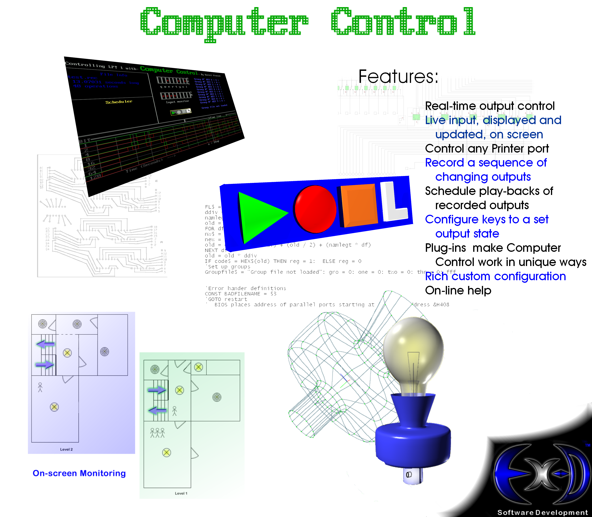
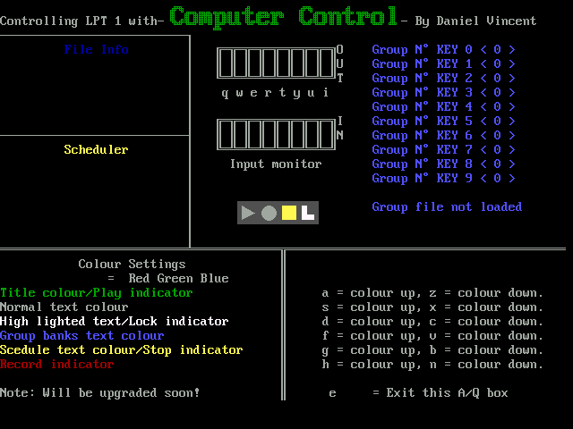

# ComputerControl

**Computer Control** is a DOS/QBASIC program that turns a PC's parallel printer port into an eight-channel controller: latch outputs from the keyboard, monitor inputs, save groups of states, record sequences, and play them back on a schedule.

It was originally written in 1999 by **Daniel Downes**, who was then known as **Daniel Vincent**. Daniel changed his name in **2000**. The earlier name remains in the original source, screenshots, and artwork as part of the historical record.

This repository preserves the original beta 5 project and its hardware/design material, alongside a 2026 HTML5 conversion with an emulated LPT port.

**[Open the GitHub Pages version](https://danieldownes.github.io/ComputerControl/)** · [Standalone offline HTML](html5/dist/computer-control.html) · [HTML5 documentation](html5/README.md)

The Pages link is ready for when GitHub Pages is enabled for this repository; publishing is configured manually as described below.

## The original poster

[](docs/images/the-poster.png)

The poster brings together the program, its timing display, interface circuitry, PCB layout, and a house-lighting concept. The README image is a lossless PNG conversion of [THE poster.bmp](Poster/THE%20poster.bmp); the original bitmap remains in the archive. Its saved modification date is December 2000.

## What the program does

- **Eight latched outputs:** `Q W E R T Y U I` switch bits 7 through 0, corresponding to DB-25 pins 9 through 2.
- **Input monitoring:** the program combines status-register and control-register bits into eight on-screen indicators.
- **Group banks:** number keys `0–9` recall complete output states; `.gro` files save sets of banks.
- **Real-time recording:** capture keyboard-controlled output changes and their timing.
- **Variable recording:** enter an output byte and delay for each step, then save it as a sequence.
- **Playback and scheduling:** replay recorded sequences immediately or from up to six scheduled banks.
- **A custom DOS interface:** VGA graphics, CP437 box drawing, palette effects, and a font routine that turns ordinary text pixels into outlined shapes.

## QBASIC techniques worth exploring

The excerpts below come from [COMPCON.BAS](CC%20beta%205%20stuff/code/COMPCON.BAS). They retain the original variable names. Where unrelated drawing or control code is omitted, a comment marks the omission. The `qbasic` code fences use GitHub's QuickBASIC syntax highlighting.

### Finding LPT ports through the BIOS data area

```qbasic
DEF SEG = 0
lpt1 = PEEK(&H408) + 256 * PEEK(&H409)
lpt2 = PEEK(&H40A) + 256 * PEEK(&H40B)
lpt3 = PEEK(&H40C) + 256 * PEEK(&H40D)
DEF SEG
```

Each port address is reconstructed from two bytes: low byte plus 256 times the high byte. `DEF SEG = 0` makes these offsets address the corresponding absolute memory locations. An address of zero indicates an absent port. This lets the program discover the machine's printer-port configuration instead of assuming LPT1 is always at `&H378`. [Source, lines 47–58](CC%20beta%205%20stuff/code/COMPCON.BAS#L47-L58).

### Latching a bit using arithmetic and a guard flag

```qbasic
IF Q = 0 THEN qon = 1: Q = 1: l = l + 128
IF Q = 1 AND qon = 0 THEN Q = 0: l = l - 128
qon = 0
```

`l` is the complete output byte, and `128` is the weight of bit 7. The first `IF` turns the bit on; the second turns it off on the next keypress. The temporary `qon` flag prevents both statements from firing on the same pass, because the first statement has already changed `Q` to 1. Other keys repeat this pattern with weights 64, 32, 16, 8, 4, 2, and 1. The resulting byte reaches the hardware with:

```qbasic
OUT Base0%, l
```

One byte therefore acts as eight independently latched switches. [Latch source, lines 399–409](CC%20beta%205%20stuff/code/COMPCON.BAS#L399-L409); [port write, line 362](CC%20beta%205%20stuff/code/COMPCON.BAS#L362).

### How real-time recording measures the gaps

Starting the recorder enables capture, clears the output byte, and takes a timer reading:

```qbasic
rrec = 1
l = 0
rrectwo = TIMER
```

The main loop then uses these statements at different points in its update cycle:

```qbasic
rrecone = TIMER
' ... output-indicator drawing ...
IF rrec = 1 THEN rrecfin = rrectwo - rrecone: rrecfin = rrecfin - rrecfin - rrecfin: WRITE #1, l, rrecfin
' ... write the output byte ...
IF rrec = 1 THEN rrectwo = TIMER
```

The long middle line is the original single-line `IF`. The expression `rrecfin - rrecfin - rrecfin` is an unusual way to negate `rrecfin`. Combined with the preceding subtraction, it produces the elapsed interval `rrecone - rrectwo`.

The recorder writes a plain text pair, **output byte, elapsed seconds**, rather than sampling all eight pins at a fixed rate. It logs program updates, including output changes, so a short file can describe a much longer performance. [Recorder setup, lines 1240–1242](CC%20beta%205%20stuff/code/COMPCON.BAS#L1240-L1242); [main loop, lines 322–365](CC%20beta%205%20stuff/code/COMPCON.BAS#L322-L365).

There is an important timing quirk: the saved source pairs the **new** byte with the interval that elapsed **before** that change. Playback uses the delay as a hold time **after** applying the byte. Those conventions can shift when changes occur relative to the recorded keyboard performance. The browser recorder makes the convention consistent by saving the byte that was being held during each measured interval; the original source and recordings are preserved unchanged.

### How playback turns those pairs back into timed output

```qbasic
INPUT #1, vbit, vtime
l = vbit
' ... display updates and stop-marker handling ...
OUT Base0%, l
```

After the byte has been output, playback waits using this loop; the original stop-key and transport-drawing statement inside `DO` is omitted here:

```qbasic
Start = TIMER
DO
    finish = TIMER - Start
LOOP UNTIL finish > vtime: GOTO nextrecbit
```

This is polling/busy-wait timing: repeatedly read the clock until the requested interval has passed, then read the next pair. There is no background thread or interrupt-driven playback engine. The loop also checks `S` so the user can stop playback. The `TIMER` midnight wrap is not handled in this subtraction. [Read and stop-marker handling, lines 315–317](CC%20beta%205%20stuff/code/COMPCON.BAS#L315-L317); [wait loop, lines 1318–1324](CC%20beta%205%20stuff/code/COMPCON.BAS#L1318-L1324).

For example, the supplied [eg3.rec](CC%20beta%205%20stuff/Program/eg3.rec) is:

```text
100,10
200,5
5,5
60,10
1,888
```

It outputs 100 for 10 seconds, 200 for 5 seconds, 5 for 5 seconds, and 60 for 10 seconds. Delay **888** is the end marker, so the timed sequence is **30 seconds**, not 918 seconds. The marker's byte is still assigned before playback stops, leaving output value **1** at normal completion. That final-state detail is reproduced by the HTML5 player.

### Combining physical input lines into one byte

```qbasic
B1% = INP(Base1%) AND &HF0
B2% = INP(Base2%) AND &HF
FullByte% = B1% OR B2%
FullByte% = FullByte% XOR &H8B
```

The upper nibble comes from the status register; the lower nibble comes from the control register. `XOR &H8B` adjusts their mixed electrical polarities. The input display later applies `255 - FullByte%`, making a LOW input show as active. Its indicator order is pins **11, 10, 12, 13, 17, 16, 14, 1**.

This is specific to the program's input scheme, rather than eight ordinary data-register inputs. Its source mapping also differs from the supplied wiring illustration, which marks pin 16 unused. The emulator labels that distinction. [Input read, lines 380–384](CC%20beta%205%20stuff/code/COMPCON.BAS#L380-L384); [input display, lines 517–545](CC%20beta%205%20stuff/code/COMPCON.BAS#L517-L545).

### Using the screen itself as a font bitmap

```qbasic
lnh% = LEN(txt$)
IF sx% = -1 THEN sx% = (640 - ((lnh% * 8) * size%)) / 2
sx2% = sx%: l% = lnh% * 8
COLOR 8: LOCATE 1, 1: PRINT txt$

FOR y% = 0 TO 15
 FOR x% = 0 TO l%
 IF POINT(x%, y%) <> 0 THEN
  IF sty% = 1 THEN LINE (sx2% - size%, sy% - size%)-(sx2%, sy%), clr%, BF
  IF sty% = 2 THEN LINE (sx2% - size%, sy% - size%)-(sx2%, sy%), clr%, B
```

This excerpt starts the `neatfont` renderer. It first prints text with the built-in font, reads those pixels back with `POINT`, and uses each lit pixel to place a larger graphical primitive. The remaining routine adds circles, triangles, points, and slanted strokes. It turns the existing 8×16 text raster into a stylized title without a separate font file. [Complete routine, lines 1983–2016](CC%20beta%205%20stuff/code/COMPCON.BAS#L1983-L2016).

## The HTML5 version



The conversion keeps a **640×480 framebuffer**, bitmap characters, CP437 borders, the original colors, and the original layout. Its recreated Colour Settings screen matches all **307,200 pixels** of the supplied screenshot. A separate panel displays the emulated DB-25 connector, register values, virtual switches, and output states.

It supports the original recordings, group import/export, recording, sequence editing, and six scheduled playback slots. It runs entirely in the browser; no physical printer port or DOS driver is involved. DOS executable plug-ins remain archival files, with a browser-native demonstration supplied in the conversion.

- **Run offline:** download `html5/dist/computer-control.html` and open it in a browser.
- **Develop locally:** run `npm start` inside `html5/`, then open `http://127.0.0.1:4173`.
- **Test:** run `npm test` inside `html5/`.
- **Refresh the standalone file and Pages entry point:** run `node scripts/update-pages.mjs` from the repository root.
- **Implementation details and deliberate fixes:** see [html5/README.md](html5/README.md).

## Repository layout

| Path | Contents |
| --- | --- |
| `CC beta 5 stuff/code/` | Four original QBASIC source files, including saved variants |
| `CC beta 5 stuff/Program/` | Compiled programs, recordings, configuration, and embedded artwork/text |
| `CC beta 5 stuff/` | Original distribution archives, installer material, screenshots, and introduction media |
| `Poster/` | Original poster, PCB and circuit drawings, CAD files, and other design assets |
| `html5/` | Browser conversion, source modules, tests, and standalone HTML |
| `docs/` | GitHub Pages entry point, README poster image, and archival timestamp/hash manifest |

## Archive dates and authorship

The original files are imported **one file per commit**, in saved modification-time order. Both the Git author date and committer date are set to the corresponding filesystem timestamp. The QBASIC code therefore appears under its surviving **August 1999** dates; later assets retain their actual 1999 or 2000 dates.

These commits are a **reconstructed archive**, imported in 2026. They are not recovered commits from an original version-control system, and a modification time does not prove when a file was first authored. The current filesystem timestamps are preserved in UTC, without inventing the old computer's timezone.

[docs/archive-manifest.json](docs/archive-manifest.json) records every archived path, its modification time, size, and SHA-256 hash. Original file bytes and line endings are preserved. Windows thumbnail caches and local build/hosting state are excluded. The HTML5 conversion and new documentation use modern commit dates.

The original source credits **Daniel Vincent**. This is the same author now known as **Daniel Downes**, following the name change in 2000.

## Enabling GitHub Pages

The repository includes a self-contained site at `docs/index.html` and a `.nojekyll` file. When ready, open **Settings → Pages**, select **Deploy from a branch**, choose **main** and **/docs**, and save.

The project URL will be **https://danieldownes.github.io/ComputerControl/**. The README link already points there. GitHub's [publishing-source documentation](https://docs.github.com/en/pages/getting-started-with-github-pages/configuring-a-publishing-source-for-your-github-pages-site) describes these settings.
